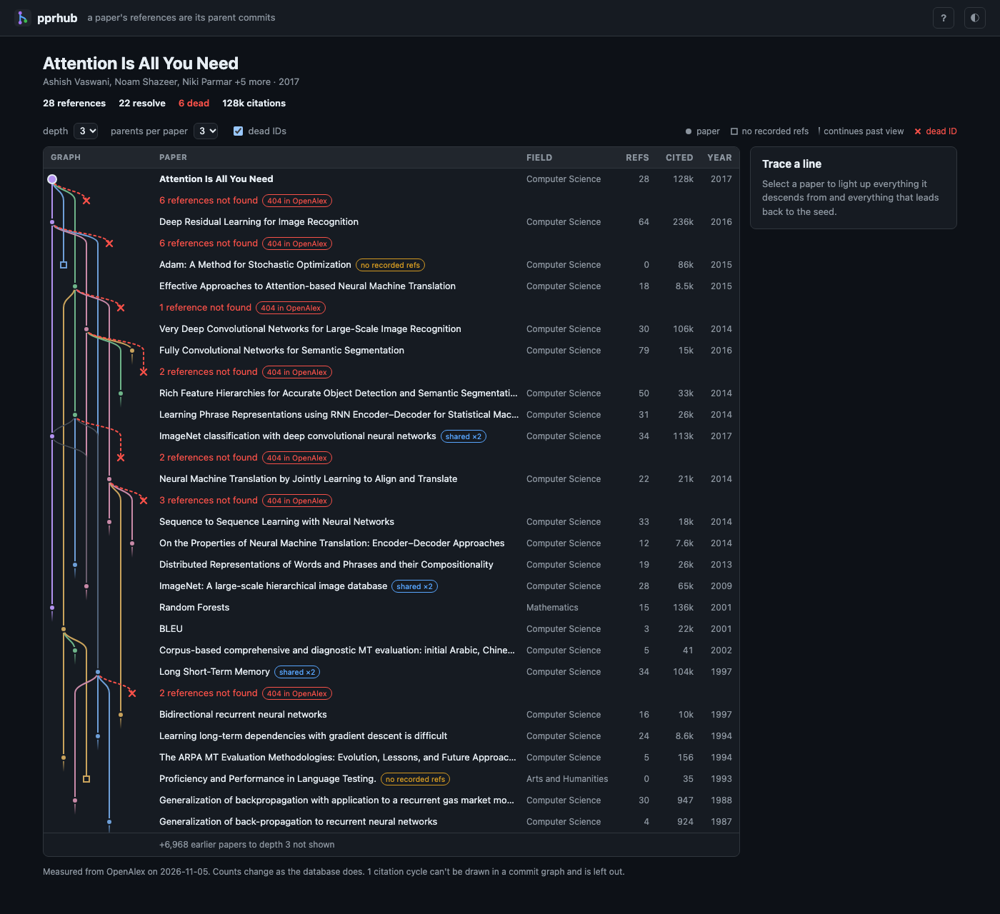

# pprhub

> A paper's references are its parent commits.

<p align="center">
  
</p>

Git records every commit's parents, so any line of code can be traced to where it came from. Papers record their parents too: the bibliography. But nobody draws it that way, and when you follow those links down, they stop sooner than you'd expect.

pprhub draws citation lineage as a commit graph. A bibliography is a merge commit, a shared ancestor is where lines join, and a dead reference is a branch that ends in a red ✗.

NOTE: pprhub is a proof-of-concept demo. It renders dated snapshots of two papers so far, and no live crawling from the browser yet.

## What's here

- **Overview**: the whole measured tree at once, one dot per paper by depth and year, with dead ends in colour. Click a dot to open that paper in the graph.
- **Rotate**: the graph has a maximum width, and its lanes sit on a loop. Drag or spin it, or use the slider. The table lists the papers on the lanes in view, in graph order, and **fixed rows** gives every paper its own row instead, with gaps where its lane is out of view. The spine stays pinned, and a tail marks a link that leaves the view: hover it to see where it goes, or click it to go there.
- **Cone**: the entire graph as a cone beside the table. The seed is the tip, the spine is the axle, and each of the seed's references holds a block of lanes around it. The table is the strip of the cone facing you, rolled flat, like the part of a tire touching the ground. Spin the cone and the table fills with that strip's papers, Scroll or pinch to zoom, and drag up or down to pan.
- **Log**: the ancestry of *Attention Is All You Need* or Watson and Crick's 1953 DNA paper as a source-tree-style graph, newest first, with the seed's most cited line as a straight spine. Choose the depth and how many parents each paper shows.
- **Expand**: `+n` on a row draws all of that paper's references, even past the depth limit if the snapshot has them. **Show all** does it for every paper.
- **Trace**: select a paper to light up its line back to the seed and everything beneath it. Its connections come into the table even if their lanes are out of view, and they stay as you turn.
- **Dead ends**: references with no OpenAlex record, and papers with no recorded references, are marked where the trail stops. A line that fades out has more references beyond the view.
- **Suspect links**: a paper dated more than two years after one citing it gets a dotted amber link, because that usually means a bad match or a wrong date.

Every number is measured from OpenAlex on the date shown. Nothing here says whether a paper is right. It shows what a paper rests on, and where the trail stops.

## Use

```bash
$ node server.js    # localhost:3838
```

Needs Node ≥18, with no dependencies. The site is static: to deploy, point any host at `public/`.

## Snapshots

```bash
$ node scripts/snapshot.js attention 1706.03762 --depth 4 --detail 3
```

This takes an arXiv ID, DOI, or OpenAlex ID, crawls the full ancestry to get measured counts per level, then writes three files to `public/snapshots/`:

- `<slug>.json`: the first load, with each paper's top five references down to `--detail`
- `<slug>.full.json`: every paper and link down to `--detail`, fetched on the first expand
- `<slug>.tree.json`: one dot per paper down to `--depth`, for the overview

Fetched papers are cached in `.snapshot-cache/`, so a long crawl can pick up where it stopped. If the budget runs out mid-crawl, it carries on with single lookups.

arXiv's own API has no reference data, so arXiv IDs are resolved through OpenAlex (`doi:10.48550/arXiv.<id>`). List calls cost $0.0001 per 50 papers from OpenAlex's $0.10 anonymous daily budget. Single lookups are free, at about 4 papers a second, and `--single` uses only those.

To add a paper to the site, list its slug in `PAPERS` in `public/js/app.js`.

An ID counts as dead only if the single-work route returns 404. Batch queries silently omit merged records, which still resolve when asked for directly.

## How the graph works

`public/lib/lineage.js` holds the pure logic, shared by the browser and the tests:

1. **`select`** walks from the seed, following each paper's top references to the chosen depth.
2. **`order`** sorts children above parents, newest first where that's possible. Years alone can't do it, because citations sometimes point forward in time. An edge that closes a citation cycle is cut and reported in the footer, since a commit graph can't draw one.
3. **`layout`** assigns lanes the way SourceTree does: a paper lands on the leftmost lane waiting for it, its most cited parent continues that lane, and other parents open new lanes or join one already waiting. Lane 0 is reserved for the seed's first-parent line. For the cone, every other lane belongs to one sector, the line of descent from one of the seed's references, so neighbouring lanes are related.
4. **`windowView`** rotates the graph: it keeps the spine plus a window of lanes on a loop, fills only the rows of papers on those lanes, and turns links leaving the window into short tails.

`public/js/graph.js` draws the result as SVG, `public/js/cone.js` draws the whole layout as a cone on canvas, and `public/js/app.js` is the rest of the page.

## Development

```bash
$ npm test    # node:test, zero deps
```

## Roadmap

- **Ground**: the per-level counts already in each snapshot, and why each chain ended
- **Revert**: the forward tree from a retraction, with the path that reaches each paper
- **Live input**: paste an arXiv ID and crawl from the browser
- **Health**: authors, recency, and trunk vs. stump shape
- **Git export**: a real repo, so `git log --graph` works on a lineage

## Data

Citation data from [OpenAlex](https://openalex.org) (CC0).
